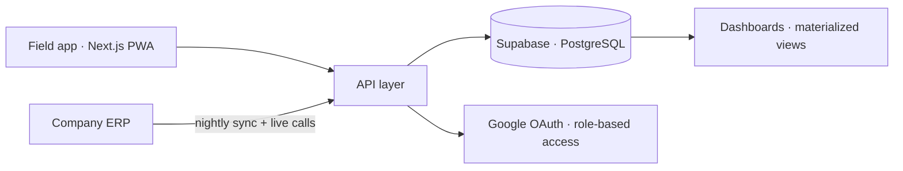

# Metatex Sales Platform — Case Study

Internal B2B sales & analytics platform for a knit-fabric manufacturer. It turned a spreadsheet-and-phone-call sales operation into a real-time, data-driven product used daily by field reps, SDRs, and management.

> ℹ️ The source code is private (proprietary business logic). This is a write-up of the work, the decisions, and the architecture.
> 🛠️ Built with Claude Code under my direction, from spec to production deploy: I wrote the specs, reviewed every change and owned the architecture and data decisions.

## Problem

The field sales team ran on WhatsApp, spreadsheets, and phone calls to the back office:

- **No single view of a client** — stock, credit, order history, and receivables lived in separate systems.
- Reps couldn't answer basic questions in the field — *is it in stock? can this client buy? what's overdue?* — without calling the office.
- Management had **no real-time view** of revenue, margins, or client risk.
- Manual, error-prone sales motions: quoting, credit checks, and order release all happened by phone and paper.

## Solution

A **mobile-first PWA** that consolidates every data source the team needs into one app, with role-specific experiences for reps, SDRs, and management.

## What it does

- **Client 360 & engagement** — health scoring, order history, live credit analysis, accounts-receivable status, and follow-up prompts, all on one screen.
- **Data consolidation** — unifies ERP master data, live inventory, receivables, and production/dyeing costs into a single trustworthy source of truth (nightly sync + live calls).
- **Workflow automation & sales motions** — a lead pipeline with SLA-driven next-actions, quick quotations with automatic pricing and PDF generation, and one-click release of financial blocks on orders.
- **Management analytics** — revenue, COGS & margins, RFM segmentation, churn, cohorts, client concentration, and portfolio-innovation tracking, with per-role dashboards.

## Architecture (high level)

- **Next.js + TypeScript** front end, installable as a PWA for the field team.
- **Supabase / PostgreSQL** as the consolidation layer, with materialized views powering fast dashboards.
- Scheduled syncs **and** live ERP calls, so reps see current stock/credit while heavy aggregates stay pre-computed.
- Role-based access (rep / SDR / management) driving what each person sees.

## Impact

- One app replaces scattered spreadsheets and phone calls for the entire daily sales motion.
- Reps self-serve stock, credit, and quoting decisions **in the field**.
- Management gets real-time margin and client-risk visibility instead of month-end guesswork.

## Lessons

- **Consolidation beats features** — the real win was one trustworthy client view, not more screens.
- **Data quality *is* the product** — most of the effort went into reconciling ERP quirks, stale statuses, and cost-data errors.
- **Role-specific dashboards drove adoption** far more than a single "do everything" view.

**Stack:** Next.js · TypeScript · Tailwind · Supabase (PostgreSQL) · NextAuth · Vercel
